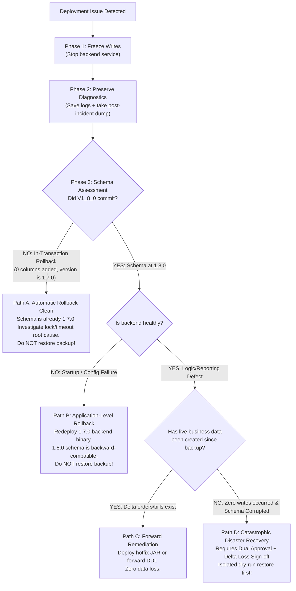

# AnnaDhara POS — GST Migration Operator Runbook (Version 1.8.0)

> **Document Type:** Production Operator Runbook  
> **Target Database:** `restaurant_pos`  
> **Schema Migration:** Flyway `1.7.0` -> `1.8.0` (`V1_8_0__add_gst_mode_and_cgst_sgst.sql`)  
> **Classification:** Operational Documentation (Read-Only Specification)  

---

## 1. Purpose and Scope

This runbook defines the controlled, audited procedure for applying Flyway migration **1.8.0** to the production PostgreSQL database (`restaurant_pos`). 

The migration introduces support for:
- Configurable GST modes (`GST_EXCLUDED` and `GST_INCLUDED`)
- Component-level tax rates (`cgst_rate` and `sgst_rate`) on restaurant configuration
- Immutable snapshotting of GST mode, component rates, and component amounts (`cgst_amount` and `sgst_amount`) on customer orders and finalized billing records

The scope is strictly limited to database schema evolution, pre/post-migration validation, and emergency triage for `restaurant_pos`.

---

## 2. Explicit Authorization Boundary

> [!CAUTION]
> **THIS DOCUMENT DOES NOT CONSTITUTE AUTHORIZATION TO EXECUTE MIGRATIONS.**  
> Execution of any step against the live production database requires **separate, explicit written sign-off** from both the Technical Lead and the Operations/Product Stakeholder.

Under no circumstances should any operator or automated pipeline execute Flyway migrations against production without:
1. Documented approval from the change advisory authority.
2. Verified completion of a fresh, restorable pre-migration backup.
3. Pre-migration revalidation of live database connectivity, version, and catalog state.

---

## 3. Reported Production Baseline Reference

The following figures represent the historical baseline state captured during Stages 3G and 3I read-only inspections. **These values derive from prior reports and must be re-verified against live production immediately prior to approved execution:**

### 3.1 Reported Schema Baseline
- **Database Name:** `restaurant_pos`
- **Current Flyway Version:** `1.7.0` (`add token version to restaurants`)
- **Target GST Columns in `public` Schema:** Exactly `0` columns exist across `restaurant_settings`, `orders`, and `bills`.

### 3.2 Reported Settings Baseline
- **Total Settings Rows:** 2
  - `id = 1` (Restaurant ID 2): Reported `default_tax_rate = 5.00`, `tax_enabled = true`
  - `id = 2` (Restaurant ID 4): Reported `default_tax_rate = 5.00`, `tax_enabled = true`

### 3.3 Reported Transactional Records & Financial Aggregates
Historical figures established during Stage 3G backup and confirmed in Stage 3I restore verification:
- **Orders:** 110 rows | Total Revenue Sum: ₹41,579.00
- **Bills:** 90 rows | Total Billed Sum: ₹35,608.00
- **Payments:** 89 rows | Total Paid Sum: ₹35,237.50

### 3.4 Verified Backup & Restore Artifacts
- **Production Backup File:** `C:\AURA2\backups\restaurant_pos_prod_backup_20261025_195207.dump` (217,836 bytes, 191 TOC entries)
- **Isolated Restore Verification Database:** `restaurant_pos_restore_verify_20261025` (100% exact parity with production baseline verified in Stage 3I)

---

## 4. GST Semantic Model & Rate Invariants

### 4.1 Definitive Meaning of `default_tax_rate`
`default_tax_rate` represents the **TOTAL / COMBINED GST RATE** for each restaurant, not an individual tax component.

### 4.2 Rate Invariant
For each restaurant settings row in `restaurant_settings`:
$$\text{Total GST Rate} = \text{default\_tax\_rate} = 5.00\%$$
$$\text{CGST Rate} = \text{ROUND}(\text{default\_tax\_rate} / 2.0, 2) = 2.50\%$$
$$\text{SGST Rate} = \text{default\_tax\_rate} - \text{cgst\_rate} = 2.50\%$$
$$\text{Invariant:} \quad \text{cgst\_rate} + \text{sgst\_rate} \equiv \text{default\_tax\_rate} \quad (2.50\% + 2.50\% = 5.00\%)$$

### 4.3 Reference Calculation Examples

#### Example 1: Standard Item (₹100.00, GST_EXCLUDED, No Discount)
- **Taxable Base:** ₹100.00
- **CGST (2.50%):** $\text{ROUND}(100.00 \times 2.50 / 100, 2) = ₹2.50$
- **SGST (2.50%):** $\text{ROUND}(100.00 \times 2.50 / 100, 2) = ₹2.50$
- **Combined Tax:** $₹2.50 + ₹2.50 = ₹5.00$
- **Grand Total:** $₹100.00 + ₹5.00 = ₹105.00$

#### Example 2: Minimal Item (₹10.00, GST_EXCLUDED, No Discount)
- **Taxable Base:** ₹10.00
- **CGST (2.50%):** $\text{ROUND}(10.00 \times 2.50 / 100, 2) = ₹0.25$
- **SGST (2.50%):** $\text{ROUND}(10.00 \times 2.50 / 100, 2) = ₹0.25$
- **Combined Tax:** $₹0.25 + ₹0.25 = ₹0.50$
- **Grand Total:** $₹10.00 + ₹0.50 = ₹10.50$

#### Example 3: Inclusive Item (₹105.00, GST_INCLUDED, No Discount)
- **Gross Amount:** ₹105.00
- **Combined Rate:** $2.50\% + 2.50\% = 5.00\%$
- **Divisor:** $1 + (5.00 / 100) = 1.05$
- **Taxable Base:** $\text{ROUND}(105.00 / 1.05, 2) = ₹100.00$
- **Total Extracted Tax:** $105.00 - 100.00 = ₹5.00$
- **CGST (2.50%):** ₹2.50 | **SGST (2.50%):** ₹2.50
- **Grand Total:** ₹105.00 (Customer pays exact menu price)

---

## 5. Staged Operator Execution Checklist

Operators must execute the following checklist sequentially during an authorized maintenance window:

### Stage 1: Pre-Flight Verification & Database Identity
1. Confirm the target database is `restaurant_pos` and the current Flyway baseline is `1.7.0`:
   ```bash
   psql -h localhost -p 5432 -U restaurant_app -d restaurant_pos -c "
   SELECT current_database(), current_user;
   SELECT version, description, success FROM flyway_schema_history ORDER BY installed_rank DESC LIMIT 1;
   "
   ```
2. Verify that 0 GST columns exist in the active schema:
   ```bash
   psql -h localhost -p 5432 -U restaurant_app -d restaurant_pos -c "
   SELECT count(*) FROM information_schema.columns 
   WHERE table_schema = 'public' 
     AND table_name IN ('restaurant_settings', 'orders', 'bills') 
     AND column_name IN ('gst_mode', 'cgst_rate', 'sgst_rate', 'cgst_amount', 'sgst_amount');
   "
   ```
   *Gate:* Must return `0`.

### Stage 2: Capture Fresh Pre-Migration Safety Backup
Capture a fresh custom-format (`-Fc`) backup immediately prior to quiescing writes:
```powershell
$timestamp = Get-Date -Format "yyyyMMdd_HHmmss"
pg_dump -h localhost -p 5432 -U restaurant_app -Fc -f "C:\AURA2\backups\restaurant_pos_pre_v1_8_0_${timestamp}.dump" restaurant_pos
Get-Item "C:\AURA2\backups\restaurant_pos_pre_v1_8_0_${timestamp}.dump" | Select-Object Name, Length
```
*Gate:* Verify non-zero file size and run `pg_restore --list` to validate TOC integrity.

### Stage 3: Quiesce Application Writes (Targeted Shutdown)
Stop the running backend service using the designated deployment/service manager. **Do not use broad process termination like `Stop-Process -Name java -Force` where it could unintentionally terminate unrelated Java processes (e.g. IDEs, build daemons, or other microservices).**

```powershell
# Method A: If running via systemd/Windows Service
# Stop-Service restaurant-pos-backend

# Method B: If running as a dedicated process listening on port 8080
$backendPort = 8080
$tcpConn = Get-NetTCPConnection -LocalPort $backendPort -ErrorAction SilentlyContinue
if ($tcpConn) {
    $procId = $tcpConn.OwningProcess | Select-Object -Unique
    $proc = Get-Process -Id $procId -ErrorAction SilentlyContinue
    if ($proc -and $proc.ProcessName -match "java") {
        Write-Host "Gracefully stopping restaurant-pos-backend (PID: $procId)..."
        Stop-Process -Id $procId -Force
    }
}
```

### Stage 4: Verify Environment Configuration (Zero Credential Leakage)
Verify that required environment variables are set in the operator session without printing sensitive passwords:
```powershell
if ([string]::IsNullOrWhiteSpace($env:DB_URL) -or 
    [string]::IsNullOrWhiteSpace($env:DB_USERNAME) -or 
    [string]::IsNullOrWhiteSpace($env:DB_PASSWORD)) {
    Write-Error "Missing required DB credentials in environment. Aborting."
    exit 1
}
Write-Host "Database connection variables verified. (Credentials masked)"
```

### Stage 5: Execute Controlled Migration Runner
Navigate to `C:\AURA2\restaurant-pos-backend` and execute the gate script:
```powershell
.\scripts\safe-migrate.ps1 -Target 1.8.0
```
*Expected Gate Sequence:*
1. Tri-state database detection confirms managed database with history table.
2. Allowlist verification confirms `1.8.0` is authorized.
3. Read-only preflight validator (`MigrationPreflightValidator`) checks catalog and exits `0`.
4. Flyway executes `flyway:migrate` inside a single PostgreSQL transaction.
5. Post-migration checksum validation (`flyway:validate`) passes.

### Stage 6: Post-Migration Database & Data Integrity Validation
Run read-only inspection queries:
```sql
-- 1. Verify Flyway records version 1.8.0 as successful
SELECT version, description, success FROM flyway_schema_history ORDER BY installed_rank DESC LIMIT 1;

-- 2. Verify all 13 target GST columns exist
SELECT count(*) FROM information_schema.columns 
WHERE table_schema = 'public' 
  AND table_name IN ('restaurant_settings', 'orders', 'bills') 
  AND column_name IN ('gst_mode', 'cgst_rate', 'sgst_rate', 'cgst_amount', 'sgst_amount');

-- 3. Verify settings backfill: 2.50% CGST + 2.50% SGST = 5.00%
SELECT id, restaurant_id, default_tax_rate, gst_mode, cgst_rate, sgst_rate FROM restaurant_settings ORDER BY id;

-- 4. Verify historical financial amounts remain completely unchanged
SELECT count(*) AS order_count, sum(total_amount) AS order_total FROM orders;
SELECT count(*) AS bill_count, sum(total_amount) AS bill_total FROM bills;
SELECT count(*) AS payment_count, sum(amount) AS payment_total FROM payments;
```

**Verification Gates:**
- Flyway latest version: `1.8.0` (`success = t`)
- Target column count: exactly `13`
- Settings rows: each has `default_tax_rate = 5.00`, `cgst_rate = 2.50`, `sgst_rate = 2.50`, `gst_mode = 'GST_EXCLUDED'`
- Order total: ₹41,579.00 (110 rows)
- Bill total: ₹35,608.00 (90 rows)
- Payment total: ₹35,237.50 (89 rows)

### Stage 7: Start Backend & Perform Read-Only Verification
1. Start the updated backend application service.
2. Perform non-destructive HTTP checks:
   - `GET /actuator/health` -> verify `{"status":"UP"}`
   - `GET /api/settings` (as Admin) -> verify:
     - `defaultTaxRate: 5.00`
     - `totalGstRate: 5.00`
     - `cgstRate: 2.50`
     - `sgstRate: 2.50`
     - `gstMode: "GST_EXCLUDED"`
     - `taxEnabled: true`
   - `GET /api/orders?page=0&size=5` -> verify legacy orders deserialize cleanly.
   - `GET /api/reports/dashboard` -> verify dashboard loads without 500 errors.

---

## 6. Smoke Testing Strategy & Operational Risk Mitigation

> [!WARNING]
> **DO NOT CREATE TEST ORDERS OR BILLS ON THE LIVE PRODUCTION DATABASE.**  
> Creating dummy transactions in production introduces permanent side effects:
> - Corrupts daily revenue, tax collections, and accountant audit ledgers.
> - Sends phantom food preparation tickets to kitchen displays (KDS) via WebSockets.
> - Distorts stock decrement tracking.

### Recommended Verification Approach:
1. **Isolated Verification First (Preferred):** Comprehensive end-to-end order creation, bill generation, and receipt printing have already been rehearsed and verified on the disposable test database (`restaurant_pos_restore_verify_20261025`).
2. **Read-Only Verification on Production:** The non-destructive checks defined in Stage 7 verify full application connectivity and serialization without creating financial records.
3. **Controlled Active Test (Strict Exception Only):** If business stakeholders explicitly mandate a live transaction test:
   - Order note must state: `"SMOKE_TEST_DO_NOT_PREPARE"`.
   - Use a minimal ₹10.00 test item.
   - Expected bill values: Taxable: ₹10.00 | CGST (2.5%): ₹0.25 | SGST (2.5%): ₹0.25 | Total: ₹10.50.
   - **Mandatory Action:** Immediately void/cancel the order via `POST /api/orders/{id}/cancel` with reason `"DEPLOYMENT_SMOKE_TEST"`.
   - Log the cancelled Order ID in the deployment record for accounting reconciliation.

---

## 7. Incident Triage, Decision Matrix & Recovery Protocol



### 7.1 Ban on `pg_restore --clean` Against Production
**NEVER execute `pg_restore --clean` as an automatic or routine rollback step against `restaurant_pos`.**
- Running `--clean` drops existing tables and overwrites the live database with the snapshot taken before the maintenance window.
- Any customer transactions, orders, or table allocations created since the backup will be permanently destroyed.
- If database locks or dependent sessions exist, `--clean` can fail midway, leaving the live database in a corrupt, partially-dropped state.

### 7.2 In-Transaction Failure Handling
PostgreSQL supports transactional DDL. In Flyway, `V1_8_0` runs within an atomic `BEGIN ... COMMIT` block.
- If migration 1.8.0 encounters a statement timeout, lock timeout, or constraint violation, PostgreSQL automatically executes a `ROLLBACK`.
- The database schema is left cleanly at version `1.7.0` with 0 target columns added.
- **Action:** Inspect Flyway and PostgreSQL logs to identify the lock conflict. Re-run preflight checks. Do not touch database backups.

### 7.3 Application-Level Rollback
The 1.8.0 schema changes are backward-compatible (new columns are nullable or have defaults).
- If the 1.8.0 backend application fails to boot due to environment, configuration, or JVM issues, the problem resides in the application container, not the database.
- **Action:** Redeploy the previous `1.7.0` backend build. The `1.7.0` application functions normally against the `1.8.0` database schema.

### 7.4 Catastrophic Recovery Governance (Last Resort Only)
A full production restore is an emergency disaster recovery action permitted only when the physical database is corrupt and irrecoverable.
**Mandatory Restraints:**
1. **Dual Executive Sign-Off:** Written authorization from Lead Engineer and Operations Stakeholder.
2. **Pre-Restore Snapshot:** Must capture a safety snapshot (`restaurant_pos_incident_<timestamp>.dump`) immediately before restoring.
3. **Data Loss (RPO) Assessment:** Explicit calculation and sign-off on the number of transactions and financial volume that will be permanently lost.
4. **Dry-Run Isolated Restore:** The target dump must first be restored into a disposable verification database (`restaurant_pos_recovery_dryrun_<timestamp>`) to confirm TOC integrity and clean exit code before touching production.

---

## 8. Security & Credential Governance

1. **Zero Secret Persistence:** Never hardcode passwords, JWT secrets, database connection strings with embedded credentials, or API tokens into documentation, scripts, or commit history.
2. **Environment Variable Injection:** Credentials must be supplied exclusively via environment variables (`DB_URL`, `DB_USERNAME`, `DB_PASSWORD`, `JWT_SECRET`).
3. **JWT Secret Best Practice:** For production deployment, generate and inject a 256-bit cryptographic key using the approved environment variable pattern:
   ```powershell
   # Example local generator (never commit output)
   $bytes = New-Object byte[] 32
   [System.Security.Cryptography.RandomNumberGenerator]::Create().GetBytes($bytes)
   $env:JWT_SECRET = [Convert]::ToBase64String($bytes)
   ```

---

## 9. Known Limitations & Pre-Execution Revalidation

1. **Reported Baselines vs. Live State:** All record counts (110 orders, 90 bills, 89 payments) and settings rates (5.00%) documented in this runbook reflect reported baselines from Stages 3G, 3I, and 3L. Live values must be freshly queried and recorded at the start of the authorized maintenance window.
2. **Readiness Scope:** This runbook documents the required procedures and safety gates; **the existence of this file does not prove production readiness or authorize live migration execution.**
